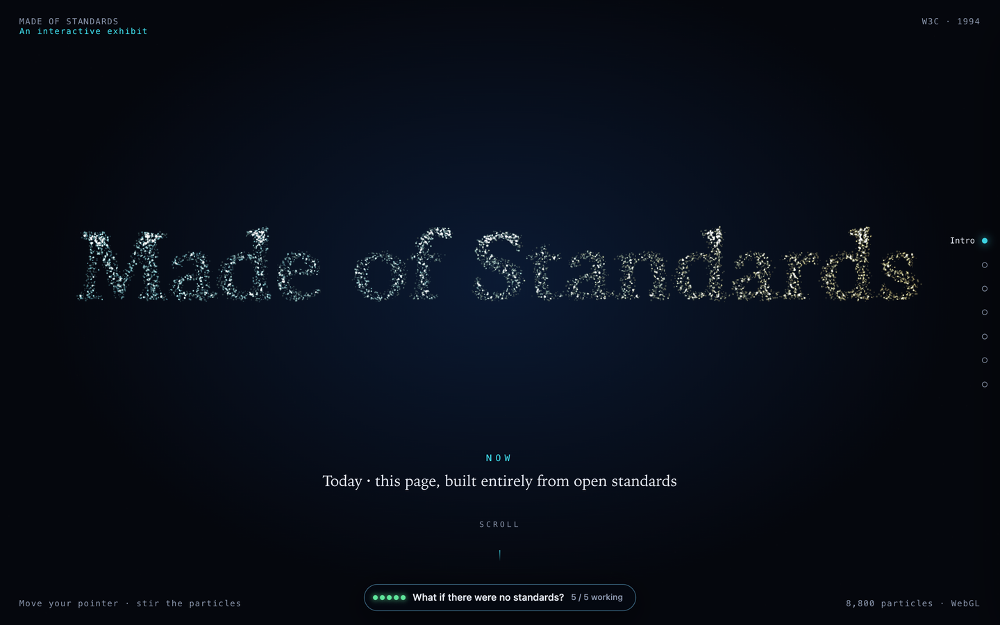

# Made of Standards

**The web is made of open standards.**

### → [Open the exhibit](https://xfq.github.io/made-of-standards/)

Every colour, animation, particle, sound and layout on the page comes from a browser API or a CSS feature that a published standard defines. The page loads no images, no audio files and no third-party scripts; there is no build step and no network request.

Then the page hands you a panel and lets you remove each standard, one at a time, so the claim is something you watch happen instead of something you read. Best on a desktop browser, with sound on.

Standards are invisible precisely because they work. This page takes it away and lets the page lose the capability in front of you, then puts it back.

## What's inside

- **Intro**: a WebGL particle field that morphs through four texts: `info.cern.ch`, W3C, “Made of Standards”, “for everyone”.
- **Thirty years, played as music**: 26 dated milestones, from the 1989 proposal to the present. Each one is a bar of music and the instrument changes with the era: chiptune, FM, synth pop, ambient. Every note is synthesized live with Web Audio.
- **The Spec Galaxy**: 174 specifications in 8 clusters on a draggable map: 173 W3C and WHATWG documents. Hover to read a name, click to open its page, or search.
- **One web, many scripts**: vertical Chinese and Japanese typeset by the browser: `writing-mode`, ruby, emphasis marks, `text-autospace`, punctuation trimming. The CSS being applied is shown alongside. Select it, copy it, or let a screen reader read it.
- **See the web through other eyes**: four colour-vision deficiencies and low vision, simulated over the whole page with SVG filters; a WCAG 2.2 contrast lab that implements the relative-luminance formula; and this page's own accessibility tree, generated live from its DOM, with speech output.

## Running it

Open `index.html` in a browser.

## Notes

“This is for everyone” is Tim Berners-Lee, London 2012 opening ceremony.

## License

- Code — the markup, CSS and JavaScript is released under the [MIT License](LICENSE).
- Text — the copy on the page and the prose in this repository — is released under [Creative Commons Attribution 4.0 International (CC BY 4.0)](https://creativecommons.org/licenses/by/4.0/).

You are free to reuse and adapt both, including commercially. If you reuse the text, credit it as:

> "Made of Standards" by Fuqiao Xue, licensed under CC BY 4.0.
> https://creativecommons.org/licenses/by/4.0/

Specification names, titles and links belong to their publishers, and quoted lines stay attributed to their authors.
